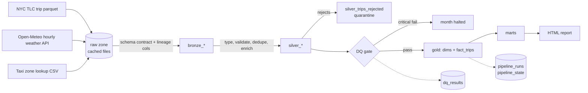

# MobilityFlow 🚕🌧️

**A production-style ELT pipeline for urban mobility data.** It ingests NYC taxi trip records and hourly weather, cleans and validates them through a medallion architecture (bronze → silver → gold) in DuckDB, and publishes analytics marts on demand patterns, congestion, weather impact and estimated CO₂ emissions.

Runs end to end on **free Google Colab** (or any laptop) — no cloud account, no paid services.

[](https://colab.research.google.com/github/sm25mtech11008-beep/mobilityflow/blob/main/notebooks/MobilityFlow_Colab.ipynb)

---

## Architecture



| Layer | Tables | What happens |
|---|---|---|
| **Raw** | `data/raw/*` | Source files downloaded once and cached (atomic `.part` → rename) |
| **Bronze** | `bronze_trips`, `bronze_weather`, `bronze_zones` | Conformed to a fixed column contract; schema drift is logged; `_source_file`, `_ingested_at` lineage columns |
| **Silver** | `silver_trips`, `silver_weather`, `silver_zones`, `silver_trips_rejected` | Typed, 9 validation rules, de-duplication by natural-key hash, derived features (duration, speed, tip %, CO₂), bad rows **quarantined with a reason**, never silently dropped |
| **Gold** | `dim_zone`, `dim_date`, `dim_weather_hour`, `fact_trips` | Star schema built with portable SQL |
| **Marts** | `mart_hourly_demand`, `mart_weather_impact`, `mart_borough_emissions`, `mart_congestion_hotspots`, `mart_od_flows` | Answer specific mobility questions |
| **Ops** | `dq_results`, `pipeline_runs`, `pipeline_state` | Audit trail, run history, incremental watermark |

## Data-engineering features

- **Incremental loads** — a watermark table records which months loaded successfully; re-runs only process new months. `--full-refresh` reprocesses.
- **Idempotency** — every monthly write uses *overwrite-partition* semantics, so re-running a month or recovering from a crash never duplicates rows (covered by a test).
- **Data-quality gate** — row count, reject rate, null keys, primary-key uniqueness, referential integrity (critical) and weather-join coverage (warning). A critical failure stops that month before it reaches gold; results are persisted every run.
- **Schema contracts** — source columns are mapped to a fixed contract (`lpep_`/`tpep_` prefixes unified, so green and yellow taxi share one pipeline).
- **Resilient extraction** — retries with exponential backoff, cached raw files, clear errors for unpublished months.
- **Memory-aware** — per-month row cap (`--max-rows`) keeps yellow-taxi runs inside free Colab RAM.
- **Portable warehouse** — DuckDB by default with an SQLite fallback; all SQL runs on both.
- **Tested & CI'd** — pytest suite (cleaning rules, dedup, schema drift, DQ gate, end-to-end idempotency/incrementality) on synthetic data with injected defects; GitHub Actions runs it on every push.

## Questions the marts answer

1. **Demand rhythm** — when and where are trips concentrated (borough × hour × weekday/weekend)?
2. **Congestion** — how much slower is the evening peak than night, and which pickup zones are slowest at peak?
3. **Weather impact** — does rain raise demand and lower speeds?
4. **Climate lens** — estimated tailpipe CO₂ by borough and the share of very short trips (< 1.5 mi) that could shift to walking, cycling or micromobility.
5. **Flows** — origin–destination volumes between boroughs.

> CO₂ is an **estimate**: trip miles × an assumed factor (`co2_g_per_mile`, default 400 g/mi, the commonly cited US EPA figure for a typical petrol passenger car). Change it in `mobilityflow/config.py` for a different fleet mix (e.g. hybrids or EVs).

## Run it

**Colab:** click the badge above and run all cells.

**Locally:**
```bash
pip install -r requirements.txt
python -m mobilityflow.pipeline --source nyc --start 2024-01 --end 2024-03   # real data
python -m mobilityflow.pipeline --source synthetic --months 2024-01            # offline
python -m pytest -q
```
Options: `--dataset yellow`, `--max-rows 200000`, `--full-refresh`, `--engine sqlite`, `--no-report`.

Output: `data/warehouse.duckdb` (query it with any SQL client) and `reports/report.html`.

## Project layout

```
mobilityflow/
  config.py      settings, thresholds, emission factor
  ingest.py      extract + schema contract + retries
  transform.py   silver cleaning rules and enrichment
  quality.py     data-quality checks and gate
  warehouse.py   DuckDB / SQLite abstraction, idempotent writes
  pipeline.py    orchestrator + CLI
  report.py      HTML report from the marts
  synthetic.py   realistic fake data with injected defects (tests/CI)
sql/gold/        dimensions, fact table, marts (portable SQL)
tests/           pytest suite
notebooks/       Colab walkthrough
```

## Data sources

- NYC Taxi & Limousine Commission trip records (public)
- Open-Meteo historical weather API (free, no key)
- TLC taxi zone lookup

## Ideas to extend

- Orchestrate with Airflow/Prefect and schedule monthly
- Port the gold SQL to dbt models with dbt tests
- Add a GTFS public-transit feed and compare taxi vs. transit travel times
- Swap the city: the same pipeline shape fits Hyderabad open mobility data when available
